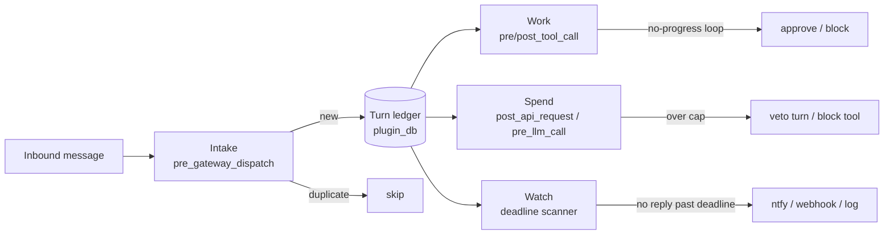

# Excubitor

[](https://github.com/catalystberry842-alt/excubitor/actions/workflows/ci.yml)

**One ledger. Four jobs. Your Hermes night sentry.**

Excubitor is a Hermes Agent plugin that watches every turn through a single SQLite ledger:

**dedup inbound replays → stop no-progress tool loops → enforce a spend cap → alert when a turn hangs.**

> Default is offline-safe (`notifier: log`). Optional `ntfy` / `webhook` only if you opt in. Fail-open on every internal error — Excubitor never takes Hermes down with it.

## Why it matters

These are real Hermes issues, not marketing horror stories:

| Source | What operators actually saw |
|---|---|
| [#143749](https://github.com/NousResearch/hermes-agent/issues/143749) | Cross-session **re-delivery** family across Feishu/WhatsApp/Telegram/Slack/… A replayed Slack root **re-ran three expensive scheduled jobs** (#131688). One Kanban board: **681 woken turns/week**, **547** of them pure noise (#136614). |
| [#96247](https://github.com/NousResearch/hermes-agent/issues/96247) | **1,523 successful `tool_search` calls** in one session filled a 130k context and died on compression. Identical-call stubs fired **1,088 times** and were ignored — advisory prose, not a block. |
| [#131145](https://github.com/NousResearch/hermes-agent/issues/131145) | First inbound turn **wedges forever**: typing forever, no provider call, no error, `active_agents` stuck after incomplete boot warm-up. |
| [#71239](https://github.com/NousResearch/hermes-agent/issues/71239) | Telegram stays “connected” while the Application **dispatcher is dead** — silent no-reply. |

Excubitor does **not** patch those core bugs. It is a plugin-side night sentry: durable inbound skip when hooks fire, mid-turn loop blocks, budget vetoes, and one hang alert — all drawn from the same ledger.

## How it works



| Stage | Hook(s) | Example |
|---|---|---|
| **Intake** | `pre_gateway_dispatch` | Same webhook `X-GitHub-Delivery` twice → second hit skipped; key survives gateway restart in `seen_messages`. |
| **Work** | `pre_tool_call`, `post_tool_call` | Model repeats `terminal` with `echo same-loop` → after threshold, `action: block` mid-turn. |
| **Spend** | `post_api_request`, `pre_llm_call`, `pre_tool_call` | Day spend above a tiny cap → next turn: `excubitor: day budget exhausted ($1.0000 / $0.00)`. |
| **Watch** | background + `agent_loop_stopped` | Open turn past deadline → one `Excubitor: turn hung` alert (verified on ntfy.sh). |

## 30-second quickstart

```bash
# Hermes must already be installed (`hermes --version`)
hermes plugins install catalystberry842-alt/excubitor
hermes plugins enable excubitor
hermes plugins doctor excubitor --ci
```

Or while developing from a clone:

```bash
git clone https://github.com/catalystberry842-alt/excubitor.git
mkdir -p ~/.hermes/plugins
ln -sfn "$(pwd)/excubitor" ~/.hermes/plugins/excubitor
hermes plugins enable excubitor
hermes plugins doctor excubitor --ci
```

> **Note:** use `owner/repo` (or a full `https://github.com/...git` URL). The `github:owner/repo` shorthand is **wrong** for current Hermes — it resolves to `github.com/github:owner/repo`.

Optional phone alerts: set `notifier: ntfy` + a **random** topic, install the [ntfy](https://ntfy.sh) app, subscribe. See [TESTING.md](TESTING.md).

## What you'll see

### `/excubitor` status (live shape)

```text
Excubitor status
  enabled: True
  day: 2026-11-05  spend $0.0072 / $5.00
  session cap: $2.00
  duplicates dropped: 0
  loops stopped: 0
  cap vetoes: 0
  alerts fired: 0
  estimated $ tracked: $0.0072
  open turns: 2
  reply deadline: 5.0 min
  loop threshold: 6 (tightens with spend)
  notifier: log
```

### Loop block (live)

```text
excubitor: no-progress loop on terminal (stagnant=3, threshold=3, spend_ratio=0.01, turn_cost=$0.0310)
```

### Cap veto (live)

```text
excubitor: day budget exhausted ($1.0000 / $0.00)
```

### Hang alert on ntfy (live)

```text
title:   Excubitor: turn hung
message: excubitor: stuck after 6 loop stop(s), no reply in 1.1 min, $0.40 spent,
         ledger note: stuck after 6 search loops
```

## vs related plugins

| Plugin | What it does | What Excubitor adds |
|---|---|---|
| [degeneracy-guard](https://github.com/simin-yuan/hermes-degeneracy-guard) | Asks before a tool call whose **args look like a repetition loop**; can rewrite degenerate stream output | Hard mid-turn **block** on same-tool+args with **no new result hashes**, plus spend-tightened threshold — one ledger shared with dedup/cap/hang |
| [usage-guard](https://github.com/mister-ideas/usage-guard) | Refuses provider calls when a **subscription usage window** is exhausted | **USD spend cap** estimated from API usage (day + session), not subscription percent |
| [tokenwatch](https://github.com/0xBernard/tokenwatch) | Token thresholds, notify, freeze tools/gateway at limits | Per-turn hang deadline + inbound **message-id dedup** + no-progress loop breaker on one spine |

They can coexist. Excubitor's pitch is the **single per-turn ledger** covering intake → work → spend → watch.

## Config

Under `plugins.entries.excubitor.settings` (also drives the Desktop Settings → Plugins form via `config_schema`):

| Key | Default | Meaning |
|---|---|---|
| `enabled` | `true` | Master kill switch |
| `day_budget_usd` | `5.0` | Day spend cap (hard veto) |
| `session_budget_usd` | `2.0` | Per-session cap |
| `reply_deadline_minutes` | `5.0` | Hang alert deadline |
| `loop_threshold` | `6` | Base no-progress count (tightens with spend) |
| `loop_approve_first` | `true` | First loop → human `approve`; later → `block` |
| `notifier` | `log` | `log` \| `ntfy` \| `webhook` |
| `ntfy_topic` | `""` | Topic when `notifier=ntfy` |
| `webhook_url` | `""` | HTTPS URL when `notifier=webhook` |
| `price_table` | `{}` | Optional model → `{input_per_mTok, output_per_mTok}` |
| `watch_interval_seconds` | `30` | Background scan period |
| `seen_ttl_hours` | `168` | Prune dedup keys older than this |
| `turn_ttl_hours` | `72` | Prune closed turns older than this |
| `max_tool_rows_per_turn` | `500` | Cap tool history rows per turn |

## Evidence

Independent clean recheck (fresh clone, fresh Hermes `main`, fresh venv/HERMES_HOME) plus earlier live runs — artifacts under [`docs/evidence/`](docs/evidence/), no secrets:

| Scenario | Result | Artifact |
|---|---|---|
| A webhook duplicate + restart | PASS | `*_a_webhook_dup.json` |
| B no-progress loop block | PASS | `*_b_loop.json` |
| C $ cap veto | PASS | `*_c_cap.json` |
| D hang → ntfy once | PASS | `*_d_hang.json`, `ntfy_poll_verify*.ndjson` |
| E `/excubitor` status | PASS | `*_e_status.json` |
| F fail-open | PASS | `*_f_failopen.json` |
| G dedup persistence | PASS (via A) | `seen_messages` row after restart |

Unit: **32** tests, **~71%** line coverage, ruff clean, CI green on `main`.

Security/quality write-up: [AUDIT.md](AUDIT.md). Reproduce: [TESTING.md](TESTING.md). Demo beat sheet: [DEMO.md](DEMO.md).

## Limitations (honest)

- **`event.internal` bypasses gateway hooks** — Excubitor never sees those paths.
- **Detects hangs; does not fix them** — you still restart / clear the wedge.
- **Cost is estimated** unless the hook payload carries an explicit USD figure.
- CLI/TUI may not fire `pre_gateway_dispatch`; those turns open the ledger later (no inbound dedup there).
- Hermes may also keep its own delivery idempotency; Excubitor's durable `seen_messages` is the plugin-side belt when hooks fire with a stable `message_id`.
- **No custom Desktop/Dashboard UI yet** — v0.1 is hooks + `/excubitor` + `config_schema` settings form. Status chips / panels are on the roadmap (Hermes does support plugin UI; see below).

## UI note (for judges)

Hermes **does** support plugin UI — three separate surfaces:

1. **Desktop Plugin SDK** (`desktop/plugin.js`) — status-bar chips, panes, palette, Settings pages
2. **Web Dashboard** (`dashboard/manifest.json`) — tabs, shell slots, optional `plugin_api.py`
3. **Automatic** — any `config_schema` key already renders under Desktop **Settings → Plugins** (Excubitor already benefits)

Excubitor v0.1 ships the automatic settings form + slash command only. Building a status chip / dashboard tab is feasible before the Nov 11 deadline and is listed on the roadmap — not claimed as done.

## Roadmap

- [ ] Desktop status-bar chip: day spend / open turns / last alert (unified `desktop/plugin.js`)
- [ ] Optional Dashboard tab with live ledger snapshot
- [ ] Richer `/excubitor` subcommands (`reset-day`, `open-turns`, `mute`)
- [ ] Catalog PR to `NousResearch/hermes-agent` `plugin-catalog/excubitor.yaml`

## FAQ

**Will this block Hermes if the plugin crashes?**  
No. Every hook is wrapped fail-open; exceptions are swallowed and logged at debug.

**Does dedup survive a gateway restart?**  
Yes — keys live in Hermes `plugin-data/excubitor/data.db`. Live test A confirmed a `seen_messages` row after restart.

**Is ntfy private?**  
Public topics on ntfy.sh are world-readable. Use a long random topic name; treat it like a capability URL.

**Can I turn it off quickly?**  
Set `enabled: false` or `hermes plugins disable excubitor`.

## License

MIT
