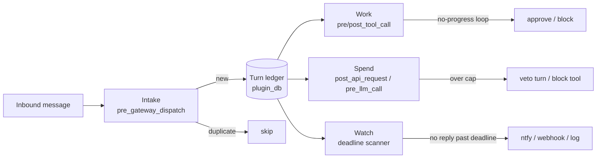

# Excubitor

[](https://github.com/catalystberry842-alt/excubitor/actions/workflows/ci.yml)

**One ledger. Four jobs. Your Hermes night sentry.**

Excubitor is a Hermes Agent plugin that watches every turn through a single SQLite ledger: **dedup inbound replays**, **stop no-progress tool loops**, **enforce a spend cap**, and **alert when a turn hangs without a reply**.

> Default is offline-safe: notifier = `log`. Optional `ntfy` / `webhook` only if you opt in. Fail-open on every internal error — Excubitor never takes Hermes down with it.

## The problem (real Hermes issues)

| Issue | What operators actually saw |
|---|---|
| [#143749](https://github.com/NousResearch/hermes-agent/issues/143749) | Cross-session **re-delivery**: the same inbound message runs a fresh turn across Feishu/WhatsApp/Telegram/Slack/… — duplicate side effects and spend. |
| [#131145](https://github.com/NousResearch/hermes-agent/issues/131145) | First inbound turn **wedges forever**: typing forever, no provider call, no error, `active_agents` stuck after incomplete boot warm-up. |
| [#71239](https://github.com/NousResearch/hermes-agent/issues/71239) | Telegram stays “connected” while the Application **dispatcher is dead** — silent no-reply. |
| [#96247](https://github.com/NousResearch/hermes-agent/issues/96247) | **1,523 successful `tool_search` calls** in one session filled a 130k context and died on compression; identical-call stubs were advisory-only. |

Excubitor does **not** patch those core bugs. It is a plugin-side night sentry: durable inbound skip when hooks fire, mid-turn loop blocks, budget vetoes, and one hang alert drawn from the same ledger.

## How it works



| Stage | Hook(s) | Example |
|---|---|---|
| **Intake** | `pre_gateway_dispatch` | Same webhook `X-GitHub-Delivery` twice → second hit skipped; key survives gateway restart in `seen_messages`. |
| **Work** | `pre_tool_call`, `post_tool_call` | Model repeats `terminal` with `echo same-loop` → after threshold, `action: block` mid-turn. |
| **Spend** | `post_api_request`, `pre_llm_call`, `pre_tool_call` | Day spend seeded above `$0.0001` cap → next turn: `excubitor: day budget exhausted ($1.0000 / $0.00)`. |
| **Watch** | background + `agent_loop_stopped` | Open turn past deadline → one `Excubitor: turn hung` alert (verified on ntfy.sh). |

Status command (live shape):

```text
Excubitor status
  enabled: True
  day: 2026-11-05  spend $0.0872 / $5.00
  session cap: $2.00
  duplicates dropped: 3
  loops stopped: 2
  cap vetoes: 1
  alerts fired: 1
  estimated $ tracked: $0.0872
  open turns: 1
  reply deadline: 5.0 min
  loop threshold: 6 (tightens with spend)
  notifier: ntfy
```

## Install

```bash
# from GitHub
hermes plugins install github:catalystberry842-alt/excubitor
hermes plugins enable excubitor

# or local path / symlink while developing
mkdir -p ~/.hermes/plugins
ln -sf /absolute/path/to/excubitor ~/.hermes/plugins/excubitor
hermes plugins enable excubitor
hermes plugins doctor excubitor --ci
```

Optional phone alerts: set `notifier: ntfy` + a **random** topic, install the [ntfy](https://ntfy.sh) app, subscribe to that topic. See [TESTING.md](TESTING.md).

## Config

Under `plugins.entries.excubitor.settings` (also driven by `plugin.yaml` `config_schema`):

| Key | Default | Meaning |
|---|---|---|
| `enabled` | `true` | Master kill switch |
| `day_budget_usd` | `5.0` | Day spend cap (hard veto) |
| `session_budget_usd` | `2.0` | Per-session cap |
| `reply_deadline_minutes` | `5.0` | Hang alert deadline |
| `loop_threshold` | `6` | Base no-progress count (tightens with spend) |
| `loop_approve_first` | `true` | First loop → human `approve`; later → `block` |
| `notifier` | `log` | `log` \| `ntfy` \| `webhook` |
| `ntfy_topic` | `""` | Topic when `notifier=ntfy` |
| `webhook_url` | `""` | HTTPS URL when `notifier=webhook` |
| `price_table` | `{}` | Optional model → `{input_per_mTok, output_per_mTok}` |
| `watch_interval_seconds` | `30` | Background scan period |
| `seen_ttl_hours` | `168` | Prune dedup keys older than this |
| `turn_ttl_hours` | `72` | Prune closed turns older than this |
| `max_tool_rows_per_turn` | `500` | Cap tool history rows per turn |

## Evidence

Live Hermes runs (gateway webhook + OpenRouter `openai/gpt-4o-mini`) are recorded under [`docs/evidence/`](docs/evidence/) — no secrets:

| Scenario | Result | Artifact |
|---|---|---|
| A webhook duplicate + restart | PASS | `*_a_webhook_dup.json` |
| B no-progress loop block | PASS | `*_b_loop.json` |
| C $ cap veto | PASS | `*_c_cap.json` |
| D hang → ntfy once | PASS | `*_d_hang.json`, `ntfy_poll_verify.ndjson` |
| E `/excubitor` status | PASS | `*_e_status.json` |
| F fail-open | PASS | `*_f_failopen.json` |
| G dedup persistence | PASS (via A) | seen row after restart |

Security/quality write-up: [AUDIT.md](AUDIT.md). How you can reproduce: [TESTING.md](TESTING.md).

## Limitations

- **`event.internal` bypasses gateway hooks** — Excubitor never sees those paths.
- **Detects hangs; does not fix them** — you still restart / clear the wedge.
- **Cost is estimated** unless the hook payload carries an explicit USD figure.
- CLI/TUI may not fire `pre_gateway_dispatch`; those turns open the ledger later (no inbound dedup there).

## FAQ

**Will this block Hermes if the plugin crashes?**  
No. Every hook is wrapped fail-open; exceptions are swallowed and logged at debug.

**Does dedup survive a gateway restart?**  
Yes — keys live in Hermes `plugin-data/excubitor/data.db`. Live test A confirmed a `seen_messages` row after restart.

**Is ntfy private?**  
Public topics on ntfy.sh are world-readable. Use a long random topic name; treat it like a capability URL.

**Can I turn it off quickly?**  
Set `enabled: false` or `hermes plugins disable excubitor`.

## License

MIT
